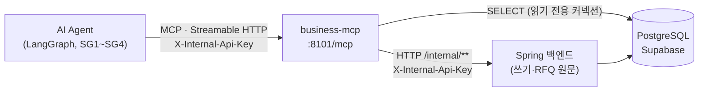
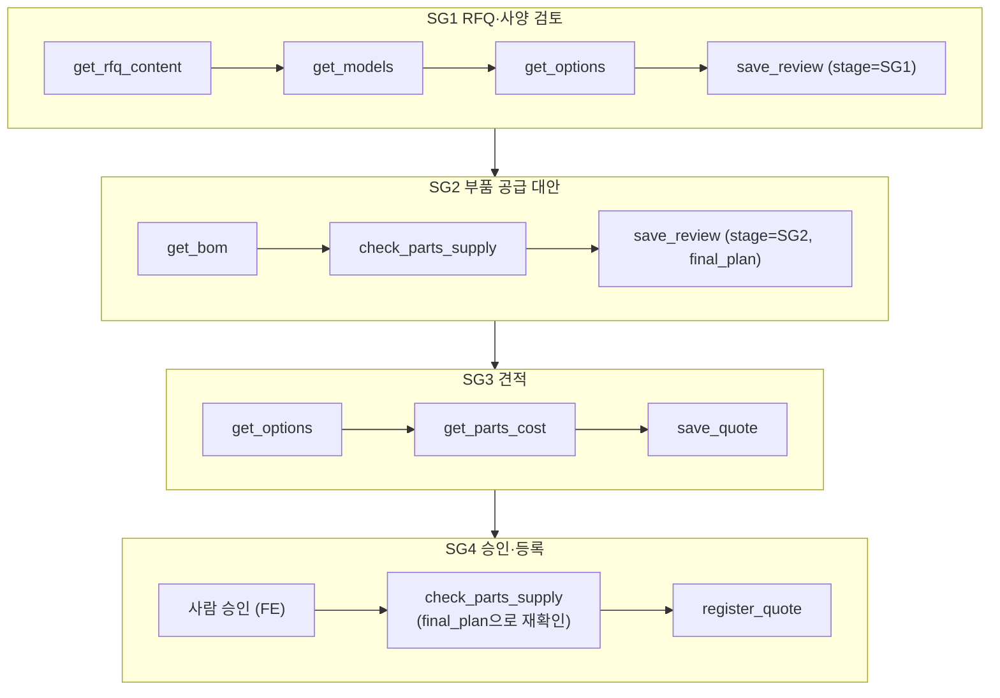
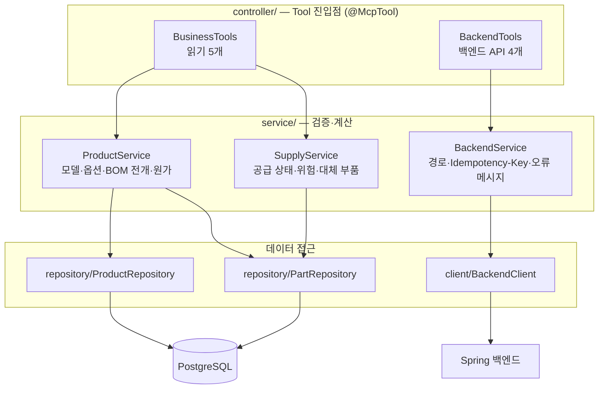
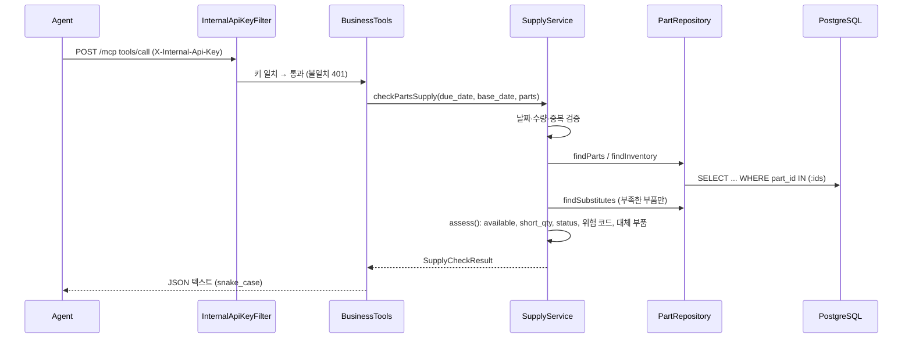

# business-mcp 구조

SupplySync-AI(RFQ·재고·구매 대응 Agent)의 **business-mcp 서버** 구조 정리.
Tool별 입출력 명세는 `CLAUDE.md`, 실행·설정 방법은 `README.md`를 본다.

## 1. 한눈에 보기



| 항목 | 값 |
|---|---|
| 역할 | Agent가 MCP로 부르는 업무 Tool 9개 제공 |
| 주소 | `http://127.0.0.1:8101/mcp` (다른 호스트 허용: `.env`의 `SERVER_ADDRESS=0.0.0.0`) |
| 전송 방식 | MCP Streamable HTTP (GET·POST·DELETE `/mcp`) |
| 인증 | 모든 요청에 `X-Internal-Api-Key` 헤더. 없거나 틀리면 401 |
| 기술 | Java 21, Spring Boot 3.5.16, Spring AI 1.1.8 (`spring-ai-starter-mcp-server-webmvc`), Spring JDBC, RestClient |
| 읽기 | PostgreSQL 직접 조회 (JdbcTemplate). 커넥션은 읽기 전용이라 쓰기 SQL은 실행 전에 거부됨 |
| 쓰기 | DB에 직접 쓰지 않음. Spring 백엔드 `/internal/**` API 호출 (팀 원칙: 쓰기는 모두 백엔드를 거친다) |
| Tool 이름 | 접두어 없음. Agent의 MCP 클라이언트가 서버 이름으로 `business_` 접두어를 붙인다 |

## 2. Tool 9개

| # | Tool | 하는 일 | 데이터 출처 | MCP 표시(hint) | 사용 SG |
|---|---|---|---|---|---|
| 1 | `get_models` | 표준 모델 사양·기본 단가 목록 | DB `models` | readOnly | SG1 |
| 2 | `get_options` | 모델에 붙일 수 있는 옵션과 효과·단가·교체 부품 | DB `models`, `model_options`, `options` | readOnly | SG1, SG3 |
| 3 | `get_bom` | 모델+옵션 기준 BOM 전개 → 부품별 필요 수량 | DB `bom`, `options`, `parts` | readOnly | SG2, SG4 |
| 4 | `check_parts_supply` | 부품별 재고·부족·입고·신규 발주 일정·위험 코드·대체 부품 | DB `parts`, `inventory`, `part_substitutes` | readOnly | SG2, SG4 |
| 5 | `get_parts_cost` | 모델+옵션 기준 부품 원가 합계와 내역 | DB (get_bom과 같은 전개) | readOnly | SG3 |
| 6 | `save_review` | SG1·SG2 분석 결과 저장 (upsert) | 백엔드 `PUT /internal/reviews/{thread_id}` | idempotent | SG1, SG2 |
| 7 | `save_quote` | 견적 초안 저장 (DRAFT, upsert) | 백엔드 `PUT /internal/quotes/{thread_id}` | idempotent | SG3 |
| 8 | `register_quote` | 승인된 견적 등록. 되돌리기 어려움 | 백엔드 `POST /internal/quotes/{quote_id}/register` | **destructive**, idempotent | SG4 |
| 9 | `get_rfq_content` | RFQ 원문 조회 (가공 없이 그대로) | 백엔드 `GET /internal/rfqs/{rfqNumber}/content` | readOnly | SG1 |

원칙: Tool은 **사실(수량·날짜·비용)과 데이터에서 바로 나오는 위험 표시만** 반환한다. 대안 비교·추천은 Agent가 한다.

### SG별 호출 흐름



- `get_bom` 결과의 `part_id`, `required_qty`를 그대로 `check_parts_supply`에 넣는다.
- SG4 재확인은 `final_plan`(예: `P-MCU-G1` 1,500 + `P-MCU-G1-ALT` 500)대로 호출한다. 대체 부품도 일반 `part_id`로 조회된다.

## 3. 코드 구조 (계층)



| 계층 | 하는 일 | 규칙 |
|---|---|---|
| `controller/` | MCP Tool 정의. 이름·한국어 설명·파라미터·hint | 파라미터 이름 = MCP 입력 필드명이라 snake_case |
| `service/` | 입력 검증, 계산, 오류 메시지 | 입력 검증은 `Inputs`로 공통화. 계산 본체(`applyOptions`, `assess`)는 DB 없이 테스트하는 순수 메서드 |
| `repository/` | DB SELECT | SQL은 이 계층에만 둔다. `NamedParameterJdbcTemplate` + 이름 붙은 파라미터(`:modelId`)만 사용. PostgreSQL·H2 공용 표준 SQL |
| `client/` | 백엔드 HTTP 호출 | 재시도 없음 (재시도 여부는 클라이언트가 판단. 오류 메시지에 HTTP 상태 코드 포함) |
| `dto/` | Tool 입출력 (Java record) | JSON은 snake_case. 금액은 정수 `_krw`, 날짜는 `YYYY-MM-DD` 문자열 |
| `config/` | API 키 필터, 시계(Asia/Seoul) | |

## 4. 디렉터리

```
SupplySync-Business-MCP/
├── CLAUDE.md                  Tool 명세 (입출력·계산·오류·테스트 기대값). 필드명 변경 시 먼저 갱신
├── README.md                  실행·설정·테스트 방법
├── ARCHITECTURE.md            이 문서
├── pom.xml                    Maven 의존성 (Spring AI MCP, JDBC, PostgreSQL, 테스트용 H2)
├── .env / .env.example        DB·API 키·백엔드 주소 (.env는 Git 제외)
├── dataset/                   (Git 제외) 지영님이 공유한 rfq_dataset_v2.2.zip을 풀어 두는 곳. 실제 DB 값 아님
└── src/
    ├── main/java/com/example/rfq/businessmcp/
    │   ├── BusinessMcpApplication.java   서버 시작점
    │   ├── config/
    │   │   ├── InternalApiKeyFilter.java X-Internal-Api-Key 검사 (401)
    │   │   └── ClockConfig.java          오늘 날짜 기준 (Asia/Seoul)
    │   ├── controller/
    │   │   ├── BusinessTools.java        읽기 Tool 5개
    │   │   └── BackendTools.java         백엔드 API Tool 4개
    │   ├── service/
    │   │   ├── ProductService.java       모델·옵션·BOM 전개·부품 원가
    │   │   ├── SupplyService.java        공급 상태·위험 코드·대체 부품
    │   │   ├── BackendService.java       백엔드 요청 조립·오류 메시지
    │   │   └── Inputs.java               공통 입력 검증 (빈 값, 양수, 날짜 형식)
    │   ├── repository/
    │   │   ├── ProductRepository.java    models, options, model_options, bom
    │   │   └── PartRepository.java       parts, inventory, part_substitutes
    │   ├── client/
    │   │   ├── BackendClient.java        get/put/post, 타임아웃, 200KB 제한, 상태 → 오류 변환
    │   │   └── BackendException.java     Tool 오류로 전달되는 예외
    │   └── dto/                          Tool 입출력 record 18개
    │       ├── ModelSpec, ModelOptions, OptionInfo                     get_models, get_options
    │       ├── BomResult, BomPart                                      get_bom
    │       ├── PartRequirement, SupplyCheckResult, PartSupply, SubstituteSupply   check_parts_supply
    │       ├── PartsCostResult, CostLine                               get_parts_cost
    │       ├── SaveReviewRequest/Result, SaveQuoteRequest/Result       save_review, save_quote
    │       └── RegisterQuoteRequest/Result, RfqContent                 register_quote, get_rfq_content
    ├── main/resources/application.yml    서버·DB·MCP·백엔드 설정 (값은 .env)
    └── test/
        ├── java/.../McpTestClient.java                 테스트 공용 MCP 클라이언트 (연결·호출·정답 파일 읽기)
        ├── java/.../BasicConfigurationTest.java        인증·Tool 9개·읽기 전용 설정 (DB 없이)
        ├── java/.../BusinessToolsIntegrationTest.java  읽기 Tool 5개, H2 + 정답 파일 비교
        ├── java/.../LiveDatabaseToolsTest.java         같은 검증을 실제 DB로 (LIVE_DB=true일 때만)
        ├── java/.../BackendToolsIntegrationTest.java   백엔드 API Tool 4개, MockRestServiceServer
        ├── java/.../service/ProductServiceTest.java    BOM 전개 단위 테스트
        ├── java/.../service/SupplyServiceTest.java     공급·위험 계산 단위 테스트
        └── resources/
            ├── schema.sql, data.sql      H2용 7개 테이블 스키마·시드 (rfq_dataset_v2.2.zip에서 복사)
            └── expected/                 정답 JSON(5_sg2, 6_sg3, 7_sg4)·RFQ 원문 (rfq_dataset_v2.2.zip에서 복사)
```

## 5. 요청 한 건의 흐름

### 읽기 Tool (예: `check_parts_supply`)



### 백엔드 API Tool (예: `register_quote`)


## 6. 핵심 계산 규칙

### BOM 전개 (`get_bom`, `get_parts_cost` 공통: `ProductService.expandBom`)
1. 모델 존재 확인, 옵션이 `model_options`에 허용된 조합인지 확인
2. `bom`에서 기본 부품 조회 → `source: "BASE"`
3. 각 옵션의 `replaces_part_id`를 `uses_part_id`로 교체 (`qty_per_unit` 유지) → `source: "OPTION:{code}"`, `replaced_part_id` 기록
4. `required_qty = qty_per_unit × qty`, `cost_krw = unit_cost_krw × qty_per_unit`
5. 출력은 `part_id` 순. `bom`에 순서 컬럼이 없어 순서에 의미를 두지 않는다

### 공급 상태 (`check_parts_supply`: `SupplyService.assess`)
| 필드 | 계산 |
|---|---|
| `available` | `on_hand − allocated` |
| `short_qty`, `status` | `max(0, required − available)`, 0보다 크면 `SHORT` 아니면 `OK` |
| `incoming_before_due` | 입고 예정(날짜·수량 > 0)이 있고 `incoming_date <= due_date` |
| `incoming_delay_days` | 납기 후 입고면 그 차이(일), 납기 전이면 0, 입고 예정 없으면 null |
| `new_order_arrival` | `base_date + lead_time_days` |
| `substitutes` | SHORT인 부품에만. `unit_cost_diff_krw`, `usable_date = base_date + validation_days`, `covers_shortage` |

위험 코드 (SHORT인 부품에만):
| 코드 | 조건 |
|---|---|
| `SHORTAGE` | `available < required_qty` |
| `INCOMING_AFTER_DUE` | 입고 예정 없음, 또는 납기 후 입고 |
| `INCOMING_INSUFFICIENT` | 납기 전 입고는 있지만 `incoming_qty < short_qty` |
| `NEW_ORDER_AFTER_DUE` | `new_order_arrival > due_date` |

## 7. 오류 처리

MCP 공식 명세 방식을 따른다. 예외를 던지면 Spring AI가 `isError: true` 결과로 바꿔 원인 메시지를 Agent에 전달한다.
`error_code`·`success_code` 같은 별도 필드는 두지 않는다 (규칙: CLAUDE.md "오류 처리 (MCP 표준)").

| 상황 | Tool 오류 메시지 |
|---|---|
| 없는 모델·허용되지 않은 옵션·BOM 없음·`qty <= 0` | 원인 메시지 (예: "모델 EWP-12-A에 허용되지 않은 옵션입니다: OPT-IP9K") |
| `check_parts_supply` 입력 오류 | 날짜 형식, 빈 `parts`, 없는 `part_id`, 재고 행 없음, 중복, `required_qty <= 0` |
| 백엔드 409 | "현재 상태에서 불가 …" (`register_quote`는 "승인되지 않은 견적") |
| 백엔드 404 / 415 (`get_rfq_content`) | "RFQ를 찾을 수 없음" / "지원하지 않는 형식" |
| 백엔드 그 밖의 4xx | "백엔드 요청 오류 (코드): 백엔드 메시지" |
| 백엔드 5xx·연결 실패·타임아웃 | "백엔드 오류 …" |
| 백엔드 응답 200KB 초과 | 크기 초과 오류 |

## 8. 설정 (.env)

| 변수 | 용도 |
|---|---|
| `DB_HOST`, `DB_PORT`, `DB_NAME`, `DB_SCHEMA` | PostgreSQL 위치 (현재 Supabase pooler) |
| `DB_USER`, `DB_PASSWORD` | 조회 전용 계정 `business_mcp_user` (7개 테이블 SELECT + RLS SELECT 정책). pooler에서는 `business_mcp_user.<project_ref>` |
| `DB_SSLMODE` | 원격 DB는 `require` |
| `DB_POOL_SIZE` | 커넥션 풀 크기 (기본 5) |
| `INTERNAL_API_KEY` | 내부 호출 공용 키. Agent → 이 서버 요청 검사와 이 서버 → 백엔드 요청 헤더에 모두 쓴다. 비어 있으면 서버 시작 실패 |
| `BACKEND_URL` | 이 서버 → 백엔드 호출 주소 (키는 `INTERNAL_API_KEY`) |
| `SERVER_ADDRESS` | 수신 주소 (기본 `127.0.0.1`) |

## 9. 테스트

| 명령 | 내용 | 필요한 것 |
|---|---|---|
| `mvn test` | 단위 + H2 통합 + 백엔드 mock (실제 DB 테스트는 건너뜀) | 없음 |
| `LIVE_DB=true mvn test -Dtest=LiveDatabaseToolsTest` | 같은 기대값을 실제 DB로 확인 + 커넥션 읽기 전용 확인 | `.env`의 DB 접속 정보 |

기대값은 `src/test/resources/expected/` 정답 파일(원본: 지영님이 공유한 `rfq_dataset_v2.2.zip`의 `05_expected/`)과 CLAUDE.md의 기대값 표를 따른다.

## 10. 외부 의존과 남은 일

| 대상 | 상태 |
|---|---|
| PostgreSQL (Supabase) | 연결·조회 확인 완료. 조회 전용 계정 `business_mcp_user` 적용 완료 (다른 테이블 읽기·쓰기는 권한에서 막힘) |
| Spring 백엔드 `/internal/**` API 4개 | 백엔드 담당 구현 대기. 지금은 mock으로만 검증 (계약은 CLAUDE.md "백엔드와 맞출 계약") |
| rag-mcp (`search_docs`) | 별도 서버. 이 레포 범위 밖 |
