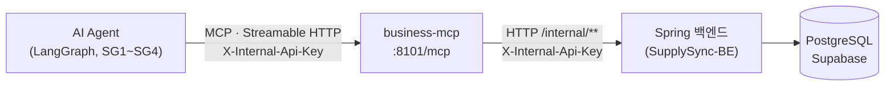
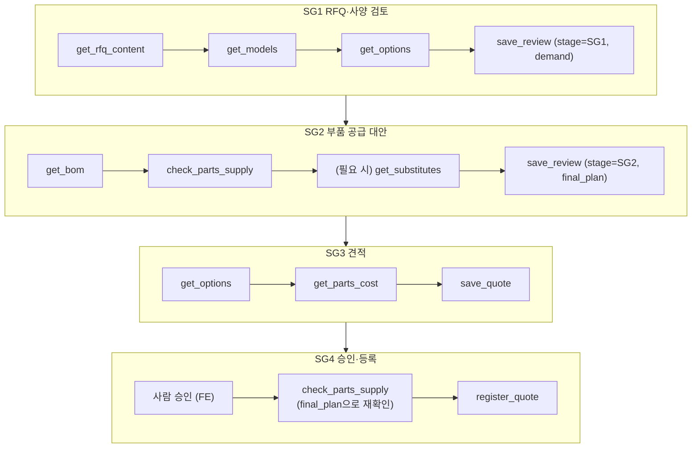
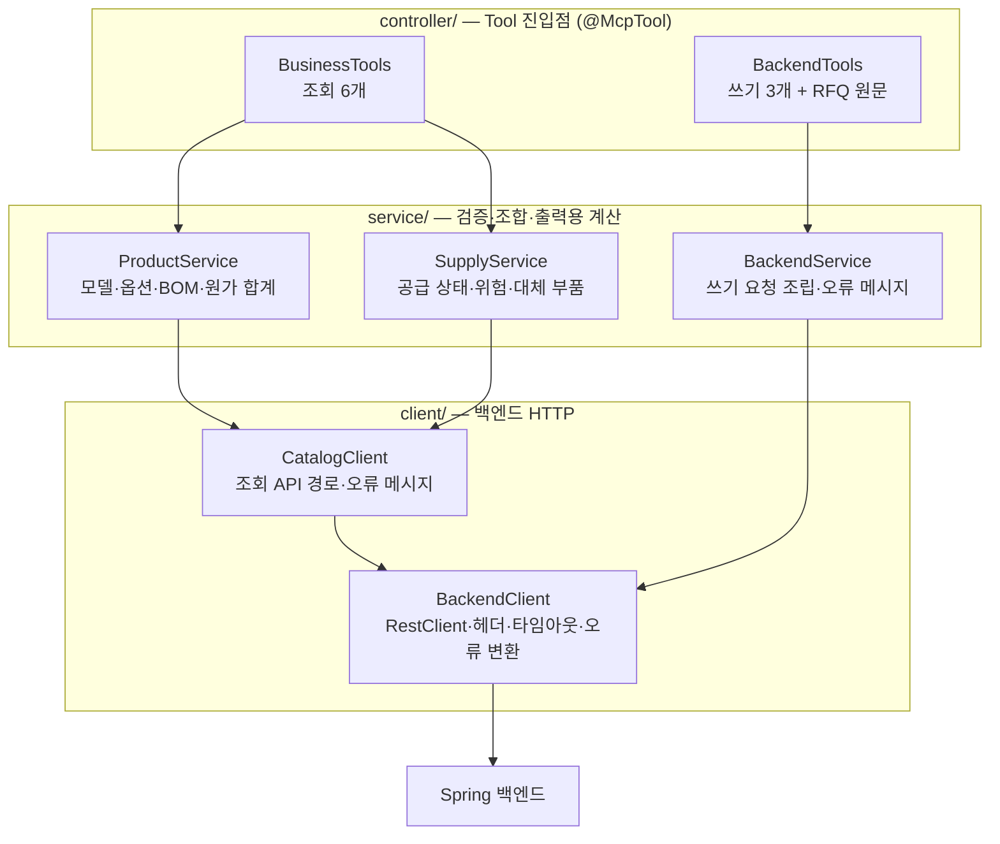
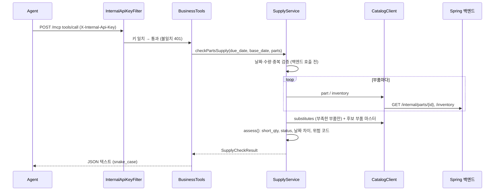
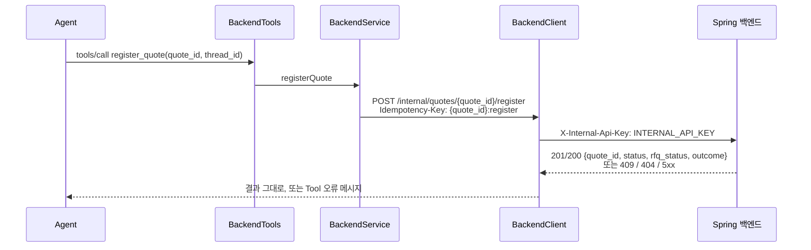

# business-mcp 구조

SupplySync-AI(RFQ·재고·구매 대응 Agent)의 **business-mcp 서버** 구조 정리.
Tool별 입출력 명세는 `CLAUDE.md`, 실행·설정 방법은 `README.md`를 본다.

## 1. 한눈에 보기



| 항목 | 값 |
|---|---|
| 역할 | Agent가 MCP로 부르는 업무 Tool 10개 제공 |
| 주소 | `http://127.0.0.1:8101/mcp` (다른 호스트 허용: `.env`의 `SERVER_ADDRESS=0.0.0.0`) |
| 전송 방식 | MCP Streamable HTTP (GET·POST·DELETE `/mcp`) |
| 인증 | 모든 요청에 `X-Internal-Api-Key` 헤더. 없거나 틀리면 401 |
| 기술 | Java 21, Spring Boot 3.5.16, Spring AI 1.1.8 (`spring-ai-starter-mcp-server-webmvc`), RestClient |
| 데이터 | **DB에 접근하지 않는다.** 조회·변경 모두 Spring 백엔드 `/internal/**` API 호출 (교재 5장: 업무 규칙은 백엔드 한 곳에만) |
| 이 서버의 일 | Tool 설명 노출 → 백엔드 API 조합 호출 → 정답 JSON 필드명으로 변환 → 오류를 LLM이 읽을 수 있는 메시지로 변환 |
| Tool 이름 | 접두어 없음. Agent의 MCP 클라이언트가 서버 이름으로 `business_` 접두어를 붙인다 |

## 2. Tool 10개

| # | Tool | 하는 일 | 백엔드 API | MCP 표시(hint) | 사용 SG |
|---|---|---|---|---|---|
| 1 | `get_models` | 표준 모델 사양·기본 단가 목록 | `GET /internal/models` | readOnly | SG1 |
| 2 | `get_options` | 모델에 붙일 수 있는 옵션과 효과·단가·교체 부품 | `GET /internal/models/{modelId}` | readOnly | SG1, SG3 |
| 3 | `get_bom` | 모델+옵션 기준 BOM → 부품별 필요 수량 | `GET /internal/models/{modelId}/bom?options=…` | readOnly | SG2, SG4 |
| 4 | `check_parts_supply` | 부품별 재고·부족·입고·신규 발주 일정·위험 코드·대체 부품 | `GET /internal/parts/{partId}`, `…/inventory`, `…/substitutes`(부족할 때만) | readOnly | SG2, SG4 |
| 5 | `get_parts_cost` | 모델+옵션 기준 부품 원가 합계와 내역 | BOM + 부품마다 `GET /internal/parts/{partId}` | readOnly | SG3 |
| 6 | `save_review` | SG1·SG2 분석 결과 저장 (upsert). `demand`가 있으면 RFQ 요구값도 저장 | `PATCH /internal/rfqs/{rfqNumber}`(demand 있을 때) → `PUT /internal/rfq-reviews` | idempotent | SG1, SG2 |
| 7 | `save_quote` | 견적 초안 생성 (DRAFT, 같은 revision이면 기존 견적) | `POST /internal/quotes` | idempotent | SG3 |
| 8 | `register_quote` | 승인된 견적 등록. 되돌리기 어려움 | `POST /internal/quotes/{quote_id}/register` | **destructive**, idempotent | SG4 |
| 9 | `get_rfq_content` | RFQ 원문 조회 (가공 없이 그대로) | `GET /internal/rfqs/{rfqNumber}` + `.../content`(text/markdown) | readOnly | SG1 |
| 10 | `get_substitutes` | 부품 하나의 대체 부품 후보 (4번 `substitutes`와 같은 형식) | `GET /internal/parts/{partId}`, `…/substitutes`, 후보마다 `GET /internal/parts/{id}` | readOnly | SG2 |

원칙: Tool은 **사실(수량·날짜·비용)과 데이터에서 바로 나오는 위험 표시만** 반환한다. 대안 비교·추천은 Agent가 한다.

### SG별 호출 흐름



- `get_bom` 결과의 `part_id`, `required_qty`를 그대로 `check_parts_supply`에 넣는다.
- SG4 재확인은 `final_plan`(예: `P-MCU-G1` 1,500 + `P-MCU-G1-ALT` 500)대로 호출한다. 대체 부품도 일반 `part_id`로 조회된다.

## 3. 코드 구조 (계층)



| 계층 | 하는 일 | 규칙 |
|---|---|---|
| `controller/` | MCP Tool 정의. 이름·한국어 설명·파라미터·hint | 파라미터 이름 = MCP 입력 필드명이라 snake_case |
| `service/` | 입력 검증, 백엔드 응답 조합, 출력용 계산, 오류 메시지 | 입력 검증은 `Inputs`로 공통화. 백엔드에 있는 값(가용 재고, 옵션 적용 BOM, 단가 차이)은 다시 계산하지 않는다. 계산 본체(`assess`, `toSubstituteSupply`)는 백엔드 없이 테스트하는 순수 메서드 |
| `client/` | 백엔드 HTTP 호출 | 경로 변수·쿼리는 URI 템플릿으로만 넣는다 (문자열 연결 금지). 재시도 없음 (오류 메시지에 HTTP 상태 코드 포함) |
| `dto/` | Tool 입출력과 백엔드 응답 (Java record) | JSON은 snake_case. 금액은 정수 `_krw`, 날짜는 `YYYY-MM-DD` 문자열 |
| `config/` | API 키 필터, 시계(Asia/Seoul) | |

## 4. 디렉터리

```
SupplySync-Business-MCP/
├── CLAUDE.md                  Tool 명세 (입출력·계산·오류·테스트 기대값). 필드명 변경 시 먼저 갱신
├── README.md                  실행·설정·테스트 방법
├── ARCHITECTURE.md            이 문서
├── pom.xml                    Maven 의존성 (Spring AI MCP, 테스트)
├── .env / .env.example        API 키·백엔드 주소 (.env는 Git 제외)
├── dataset/                   (Git 제외) 지영님이 공유한 rfq_dataset_v2.2.zip을 풀어 두는 곳
└── src/
    ├── main/java/com/example/rfq/businessmcp/
    │   ├── BusinessMcpApplication.java   서버 시작점
    │   ├── config/
    │   │   ├── InternalApiKeyFilter.java X-Internal-Api-Key 검사 (401)
    │   │   └── ClockConfig.java          오늘 날짜 기준 (Asia/Seoul)
    │   ├── controller/
    │   │   ├── BusinessTools.java        조회 Tool 6개
    │   │   └── BackendTools.java         쓰기 3개 + RFQ 원문
    │   ├── service/
    │   │   ├── ProductService.java       모델·옵션·BOM·부품 원가
    │   │   ├── SupplyService.java        공급 상태·위험 코드·대체 부품
    │   │   ├── BackendService.java       쓰기 요청 조립·오류 메시지
    │   │   └── Inputs.java               공통 입력 검증 (빈 값, 양수, 날짜 형식)
    │   ├── client/
    │   │   ├── BackendClient.java        get/put/patch/post, 타임아웃, 200KB 제한, 상태 → 오류 변환
    │   │   ├── CatalogClient.java        조회 API 6개 경로·오류 메시지
    │   │   └── BackendException.java     Tool 오류로 전달되는 예외
    │   └── dto/
    │       ├── ModelSpec, ModelOptions, OptionInfo                     get_models, get_options
    │       ├── BomResult, BomPart                                      get_bom
    │       ├── PartRequirement, SupplyCheckResult, PartSupply, SubstituteSupply   check_parts_supply
    │       ├── SubstituteResult                                        get_substitutes
    │       ├── PartsCostResult, CostLine                               get_parts_cost
    │       ├── SaveReviewRequest/Result, SaveQuoteRequest/Result       save_review, save_quote
    │       ├── RfqDemand                                               save_review의 demand (PATCH 본문)
    │       ├── RegisterQuoteRequest/Result, RfqInfo, RfqContent        register_quote, get_rfq_content
    │       └── BackendCatalog                                          백엔드 조회 응답 (Model, Bom, Part, Inventory, Substitute)
    ├── main/resources/application.yml    서버·MCP·백엔드 설정 (값은 .env)
    └── test/
        ├── java/.../McpTestClient.java                 테스트 공용 MCP 클라이언트 (연결·호출·정답 파일 읽기)
        ├── java/.../FakeBackend.java                   백엔드 조회 API 흉내 (fixture를 URL별로 응답)
        ├── java/.../ReadToolsContract.java             조회 Tool 6개 기대값 검증 (mock·실제 공용)
        ├── java/.../BasicConfigurationTest.java        인증·Tool 10개 (백엔드 없이)
        ├── java/.../BusinessToolsIntegrationTest.java  조회 Tool, mock 백엔드 + 호출 경로·횟수
        ├── java/.../LiveBackendToolsTest.java          같은 검증을 실제 백엔드로 (LIVE_BACKEND=true일 때만)
        ├── java/.../BackendToolsIntegrationTest.java   쓰기·RFQ 원문 Tool, MockRestServiceServer
        ├── java/.../service/ProductServiceTest.java    옵션 정리·전압 표기 단위 테스트
        ├── java/.../service/SupplyServiceTest.java     공급·위험·대체 부품 계산 단위 테스트
        └── resources/
            ├── backend/                  백엔드 조회 응답 fixture (v2.2 시드, 백엔드 응답 형식 그대로)
            └── expected/                 정답 JSON(5_sg2, 6_sg3, 7_sg4)·RFQ 원문 (rfq_dataset_v2.2.zip에서 복사)
```

## 5. 요청 한 건의 흐름

### 조회 Tool (예: `check_parts_supply`)



데모(B + 옵션 2개, 부품 6개 중 1개 부족) 기준 백엔드 호출 14회: 부품 6 × 2 + 대체 후보 1 + 후보 부품 마스터 1. 부품 마스터는 요청 안에서 한 번만 조회한다.

### 쓰기 Tool (예: `register_quote`)



## 6. 핵심 계산 규칙

### BOM (`get_bom`, `get_parts_cost` 공통: `ProductService.expandBom`)
- 모델 존재·옵션 조합 검사와 옵션 부품 교체는 **백엔드가 한다** (이 서버에서 다시 구현하지 않음)
- 이 서버: 옵션 중복 제거·빈 코드 검사, `required_qty = qty_per_unit × qty`, `cost_krw = unit_cost_krw × qty_per_unit`, 합계
- 출력은 `part_id` 순. `bom`에 순서 컬럼이 없어 순서에 의미를 두지 않는다
- 백엔드가 빈 BOM을 주면(모델 C) "BOM이 없습니다" 오류

### 공급 상태 (`check_parts_supply`: `SupplyService.assess`)
| 필드 | 계산 |
|---|---|
| `available` | 백엔드 재고 응답 값 (`on_hand − allocated`) |
| `short_qty`, `status` | `max(0, required − available)`, 0보다 크면 `SHORT` 아니면 `OK` |
| `incoming_before_due` | 입고 예정(날짜·수량 > 0)이 있고 `incoming_date <= due_date` |
| `incoming_delay_days` | 납기 후 입고면 그 차이(일), 납기 전이면 0, 입고 예정 없으면 null |
| `new_order_arrival` | `base_date + lead_time_days` |
| `substitutes` | SHORT인 부품에만. `available`·`unit_cost_diff_krw`는 백엔드 값, `usable_date = base_date + validation_days`, `covers_shortage` |

`get_substitutes`도 같은 메서드(`toSubstituteSupply`)로 대체 부품을 만든다. `short_qty`를 주지 않으면 `covers_shortage`는 null.

위험 코드 (SHORT인 부품에만):
| 코드 | 조건 |
|---|---|
| `SHORTAGE` | `available < required_qty` |
| `INCOMING_AFTER_DUE` | 입고 예정 없음, 또는 납기 후 입고 |
| `INCOMING_INSUFFICIENT` | 납기 전 입고는 있지만 `incoming_qty < short_qty` |
| `NEW_ORDER_AFTER_DUE` | `new_order_arrival > due_date` |

## 7. 오류 처리

MCP 공식 명세 방식을 따른다. 예외를 던지면 Spring AI가 `isError: true` 결과로 바꿔 원인 메시지를 Agent에 전달한다.
`error_code`·`success_code` 같은 별도 필드는 두지 않는다 (규칙: CLAUDE.md "오류 처리 (MCP 표준)").
백엔드 오류 응답(`{code, message, details, timestamp}`)의 `message`는 "(백엔드: …)"로 뒤에 붙인다.

| 상황 | Tool 오류 메시지 |
|---|---|
| 없는 모델 (백엔드 404) | "존재하지 않는 모델입니다: EWP-99 (백엔드: …)" |
| 허용되지 않은 옵션 (백엔드 400) | "모델 EWP-12-A에 허용되지 않은 옵션이 있습니다 (요청: [OPT-IP9K]) (백엔드: 모델에 적용할 수 없는 옵션입니다: OPT-IP9K)" |
| BOM 없음·`qty <= 0`·빈 옵션 코드 | 이 서버의 원인 메시지 |
| 없는 부품·재고 없음 (백엔드 404) | "존재하지 않는 부품입니다: …" / "재고(inventory) 정보가 없는 부품입니다: …" |
| `check_parts_supply` 입력 오류 | 날짜 형식, 빈 `parts`, 중복, `required_qty <= 0` (백엔드 호출 전에 검사) |
| 백엔드 409 | "현재 상태에서 불가 …" (`register_quote`는 "승인되지 않은 견적") |
| 백엔드 404 (`get_rfq_content`) | RFQ 정보: "RFQ를 찾을 수 없음" / 원문: "RFQ 원문이 없거나 읽을 수 없음" |
| 백엔드 404 (`save_quote`) | "분석 결과 또는 모델을 찾을 수 없음 (save_review를 먼저 호출 …)" |
| `save_review` 두 호출 중 실패 | "demand(RFQ 요구값) 저장 실패 …" 또는 "demand는 저장됐지만 분석 결과 저장 실패 …" (둘 다 멱등이라 다시 호출하면 됨) |
| 백엔드 그 밖의 4xx | "백엔드 요청 오류 (코드): 백엔드 message [details]" |
| 백엔드 5xx·연결 실패·타임아웃 | "백엔드 오류 …" |
| 백엔드 응답 200KB 초과 | 크기 초과 오류 |

## 8. 설정 (.env)

| 변수 | 용도 |
|---|---|
| `INTERNAL_API_KEY` | 내부 호출 공용 키. Agent → 이 서버 요청 검사와 이 서버 → 백엔드 요청 헤더에 모두 쓴다. 비어 있으면 서버 시작 실패 |
| `BACKEND_URL` | 이 서버 → 백엔드 호출 주소 (기본 `http://localhost:8080`) |
| `SERVER_ADDRESS` | 수신 주소 (기본 `127.0.0.1`) |

## 9. 테스트

| 명령 | 내용 | 필요한 것 |
|---|---|---|
| `mvn test` | 단위 + mock 백엔드 통합 (실제 백엔드 테스트는 건너뜀) | 없음 |
| `LIVE_BACKEND=true mvn test -Dtest=LiveBackendToolsTest` | 같은 기대값을 실제 백엔드로 확인 (조회 Tool + `get_rfq_content`) | 백엔드 demo 실행, `.env`의 `BACKEND_URL`·`INTERNAL_API_KEY` |

기대값은 `src/test/resources/expected/` 정답 파일(원본: 지영님이 공유한 `rfq_dataset_v2.2.zip`의 `05_expected/`)과 CLAUDE.md의 기대값 표를 따른다.

## 10. 외부 의존과 남은 일

| 대상 | 상태 |
|---|---|
| Spring 백엔드 `/internal/**` | 백엔드 구현 완료 (SupplySync-BE main, 2026-10-21). 이 서버는 mock으로 검증. 실제 백엔드 연결 확인(`LiveBackendToolsTest`)은 남음 |
| 백엔드 `evidence` 저장 | 백엔드 DTO에 필드 추가 필요 (이 서버는 그대로 전달 중) |
| 조회 전용 DB 계정 `business_mcp_user` | 더 이상 쓰지 않음. Supabase에서 정리할지 팀 결정 |
| rag-mcp (`search_docs`) | 별도 서버. 이 레포 범위 밖 |
